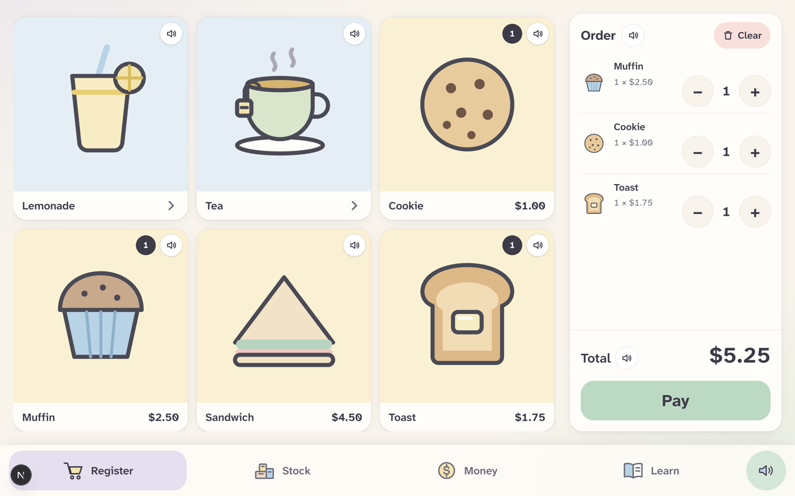
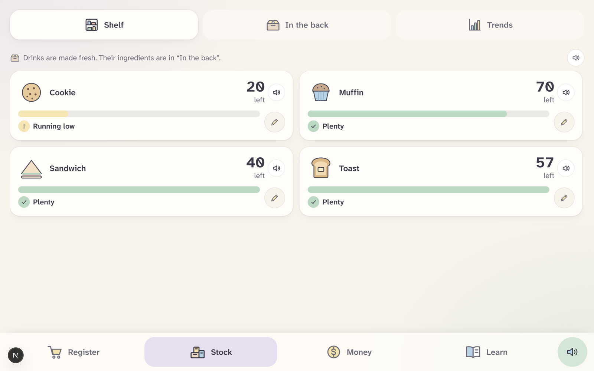
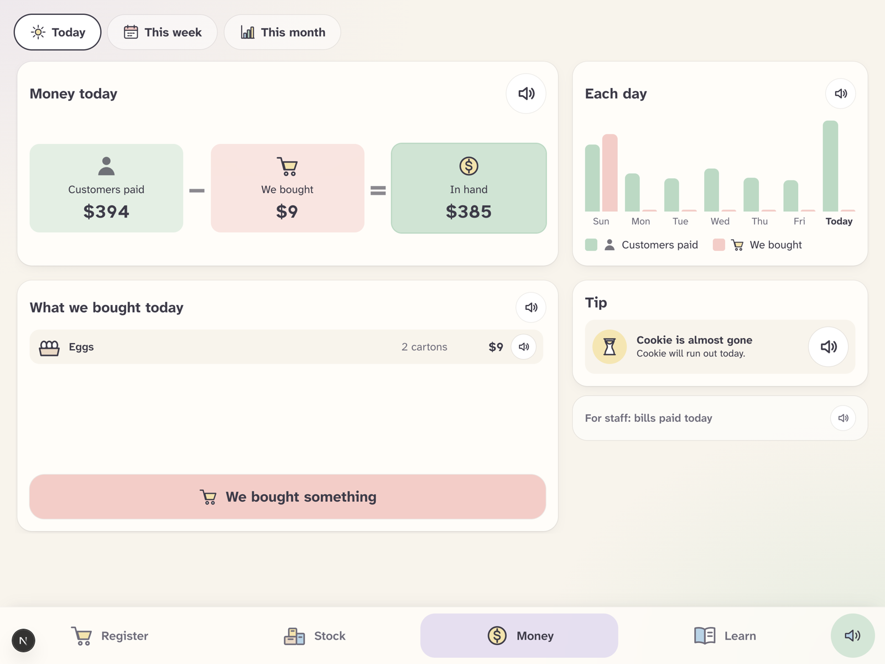
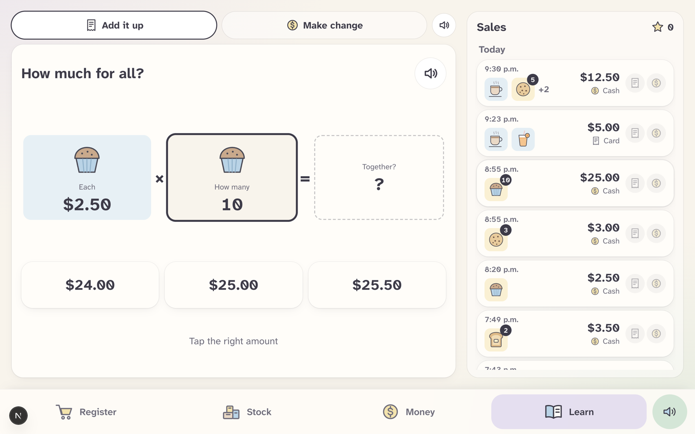
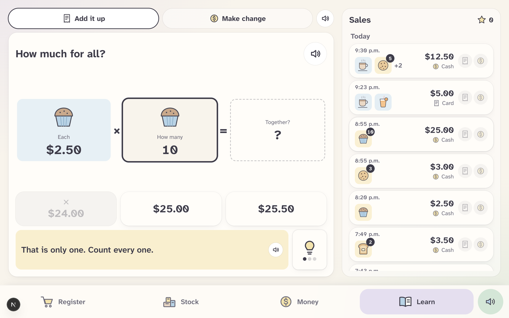
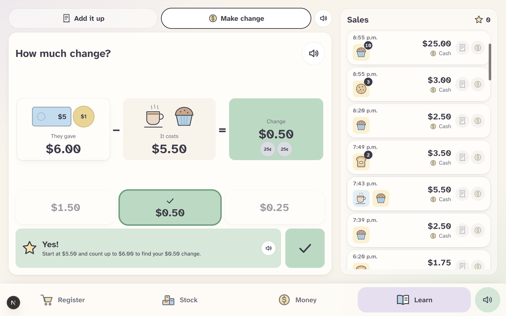

# KW Habilitation Café POS

A café register and money-learning app for the social-enterprise café run by KW Habilitation, built for CommuniHacks. The cashier is a person with an intellectual disability who finds reading and maths hard, so the whole app is **picture-first**: big touch targets, calm colours, very little text, whole-dollar amounts where possible, and everything can be read aloud. It also helps the café's staff see how the business is doing (sales, spending, stock, what is left over) in plain terms. All data is fake.

## What it does

The app has four screens, one tab each:

- **Register**: tap pictures to build an order, pick a size for drinks, then pay with cash (tap the bills and coins the customer gave and see the change to hand back) or card. It keeps working without Wi-Fi: a sale waits on the tablet and is sent when the connection is back, counted once.
- **Stock**: what is on the shelf and in the back room, as pictures and "% full". Drinks are made to order, so the number that matters is how many more the café can still make from its ingredients. Staff can count stock, and the app suggests what to buy, aware of busy weekdays.
- **Money**: money in hand, what came in versus what was spent, whether the monthly bills are covered, what is left over this month, and the busiest hours. Staff can record a supply purchase, which also updates stock. Three short insights in plain words sit at the top.
- **Learn**: a log of every real sale. From any sale the cashier practises **adding up** (why the items make the total) and **making change**. It works like Khan Academy: wrong answers grey out, up to three hints, a short "why", and a star for a clean run. Gemini writes the hints, but never gives the answer.

Requirements from the café that this covers: tracking sales, expenses and profit; a budget that carries its balance forward; a dashboard; inventory and forecasting (restock suggestions); and a learning tool that makes money in, money out and money left legible.

## Screenshots

|                                                                                         |                                                                          |
| --------------------------------------------------------------------------------------- | ------------------------------------------------------------------------ |
|               |  |
| **Register**: tap pictures to build an order, then pay                                  | **Stock**: what is left, with a warning when something runs low          |
|      |         |
| **Money**: customers paid minus what we bought equals money in hand                     | **Learn, add it up**: "$2.50 each × 10 muffins = ?"                      |
|                   |             |
| **Learn, a hint**: a wrong answer greys out and a hint helps, without giving the answer | **Learn, make change**: what they gave, what it costs, the change        |

## How it is built

Stack: Next.js 16 (App Router) · React 19 · TypeScript · Tailwind CSS 4 · Tiger Data (Postgres + TimescaleDB) · ElevenLabs · Google Gemini. It runs locally (`npm run dev`) for the demo; there is no hosted deployment.

- **Tiger Data** stores every sale as time-series data and feeds the dashboards (details under "Database" below).
- **Gemini** words the Learn hints and the Money insights. Numbers and right answers are always worked out in code, never by the AI, and fixed wording is used if Gemini is slow or down.
- **ElevenLabs** reads every speaker button aloud, with the browser's own voice as a fallback.
- It is a PWA: it can be installed on a tablet, and the register opens offline.

## Run

```bash
npm install && npm run dev     # http://localhost:3000
```

No env vars are needed to start: every API route returns mock data. Copy `.env.example` to `.env.local` to connect Tiger Data, ElevenLabs and Gemini. Without `GEMINI_API_KEY`, insights and Learn hints use fixed, local wording.

### Read aloud (ElevenLabs)

Every speaker button reads its text aloud through `POST /api/speak`, which calls ElevenLabs text-to-speech. The API key stays on the server (`src/app/api/speak/route.ts`); the browser never sees it.

1. Create a key at https://elevenlabs.io/app/api/api-keys and put it in `.env.local` as `ELEVENLABS_API_KEY=...` (never commit it).
2. Optional: `ELEVENLABS_VOICE_ID` (the default is Jessica, a bright, warm voice; other choices are listed in `.env.example`, or copy any voice's ID from the Voice Library) and `ELEVENLABS_MODEL` (default `eleven_flash_v2_5`).
3. Restart `npm run dev`. Without a key, or if ElevenLabs is down or out of credits, the speaker falls back to the browser's built-in voice, so the app always talks.

To save credits, a sentence is generated once and reused (server cache, plus the page remembers what it already fetched), a sentence can be at most 1000 characters, and at most 60 new sentences are sent per minute (`ELEVENLABS_MAX_PER_MINUTE`). Tap a speaker again to stop it.

### Button sounds

Buttons make small sounds: a soft pop when something is added (an item, a bill, a stock count), a soft drop when it is removed, a chime when something is saved, a cash register bell when a sale is saved, and two gentle falling notes when something goes wrong. They are short, quiet and built in the browser (`src/lib/sounds-synth.ts`), so they play instantly and need no files or keys. The speaker button in the nav bar turns them off, and that choice is remembered on the device.

`SoundProvider` (mounted once in the layout) finds the right sound by a button's label ("One more...", "Add $20", "50 less"), or by `data-sound="add" | "remove" | "tap" | "none"` on the button.

Optional: `npm run sounds` makes ElevenLabs Sound Effects versions of them in `public/sounds` (the key needs the Sound Effects permission). Once `public/sounds/manifest.json` exists the app plays those files; delete it to go back to the built-in sounds.

### Learn page (Gemini)

The Learn tab lists every sale (`src/app/learn`). Pick one and practise:

- **Add it up**: why the items make the total. A big order is grouped, so "10 muffins and a coffee" is two questions ("$2.50 each × 10", then adding the coffee), not ten.
- **Make change**: what the customer gave, what it cost, and the change. The database does not store the cash handed over, so it is worked out from the total (the next bill up). Card sales say "Pretend they gave", because no cash changed hands.

Like Khan Academy: wrong answers grey out, up to three hints, a short "why" after the right answer, and a star for a clean run (kept in the browser, `learn-progress-v1`).

Gemini only words the hints and the "why" (`POST /api/learn/hint`, `POST /api/learn/explain`). **Code decides what is right**: the rules and the three answer choices are in `src/lib/learn.ts`, the server rebuilds each question from the stored sale (the browser never sends prices or answers), and every Gemini sentence is checked so it cannot give the answer away (no answer digits or number words). If Gemini is slow, rate-limited or down, fixed wording from the same file is used with no error. The Learn routes only read from the database; they never write.

Test it with `npx tsx src/lib/learn.test.ts` (1,900 generated questions plus hand-written cases). It also runs under `npm test`.

### Database (Tiger Data)

1. Get the `DATABASE_URL` from the team lead (privately, never in git) and put it in `.env.local`.
2. `npm run db:schema` creates the tables (safe to re-run). `npm run db:seed` fills 30 days of fake history, and **wipes** these tables first.
3. With `DATABASE_URL` set, every route in `src/app/api` reads and writes the real database. Without it, they return mock data.

Tiger Data features in use: hypertables with columnstore compression (`sales`, `sale_items`, `stock_movements`), real-time continuous aggregates (`sales_daily`, `sales_hourly`, `item_daily`) with refresh policies, and `time_bucket_gapfill` for charts with no holes. Also: `/api/busy-hours` (sales by hour of day), a weekday-aware `/api/restock-suggestions` (with `daysLeft`).

Drinks are made to order, so they have no shelf count. The `recipes` table says how much of each back-room ingredient a Small / Medium / Large uses (coffee beans in g, tea leaves in g, milk and lemonade in ml, oranges for fresh juice, sugar in pouches for coffee and hot chocolate, plus a cup and a lid). Selling a drink subtracts its recipe in the same transaction as the sale and logs it in `stock_movements` as "use"; its cost is what those ingredients cost. The register's "can still make" number for a drink comes from the ingredients. Back-room items are bought in packs (`pack_name`, `pack_size`, price per pack) and measured ones show "% full" against `full_qty`.

Stock counts: `POST /api/inventory/count` (shelf items) and `POST /api/supplies/count` (back room; the change is logged in `stock_movements` as an adjustment). The Stock tab's "✏️ Count" buttons use them.

Back-room stock (ingredients, packaging, supplies) is at `/api/supplies`; stock changes are logged via `POST /api/supplies/movements`. `/api/inventory` and `/api/menu` are the sellable items.

## Where things go

| Path                                   | What                                                             |
| -------------------------------------- | ---------------------------------------------------------------- |
| `src/app/<screen>/page.tsx`            | Screens: `register`, `stock`, `money`, `learn`                   |
| `src/app/api/**/route.ts`              | One file per API route                                           |
| `src/components/<area>/`               | UI pieces: `register`, `stock`, `money`, `learn`, `voice`, `nav` |
| `src/lib/types.ts`                     | **Shared contract.** Money is always whole cents                 |
| `src/lib/db.ts`                        | Tiger Data client (`query()`) — server only                      |
| `src/lib/mock-data.ts`                 | Fake data the API returns until the DB is wired                  |
| `src/lib/images.ts`                    | Menu picture URLs (drawings in `public/images/menu/`)            |
| `src/lib/speech.ts`                    | Words to say aloud + the browser-voice fallback                  |
| `src/lib/elevenlabs.ts`                | ElevenLabs text-to-speech (server only)                          |
| `src/lib/explain.ts`                   | Simple-words explanations (local rules)                          |
| `src/lib/metrics.ts`                   | Insight numbers, computed in code (never by the AI)              |
| `src/lib/insights.ts`                  | Picks top 3 insights; Gemini wording + local fallback            |
| `src/lib/integrations/gemini.ts`       | Gemini calls (structured JSON): insights, Learn hints            |
| `src/lib/learn.ts`                     | Learn rules: questions, answers, hints, checks                   |
| `src/lib/learn-data.ts`                | Learn's read-only sales query (server only)                      |
| `src/styles/tokens.css`                | Colours, touch size, font sizes (Tailwind `@theme`)              |
| `src/app/manifest.ts`, `public/icons/` | PWA manifest + icons                                             |
| `db/schema.sql`                        | Database schema (`npm run db:schema`, needs `psql`)              |
| `scripts/seed.ts`                      | Fake data seed (`npm run db:seed`)                               |

Tailwind 4 is configured in CSS, so there is no `tailwind.config.js`: tokens in `src/styles/tokens.css` become utilities such as `bg-sage`, `min-h-touch`, `text-number` and `rounded-tile`.

## Scripts

`dev` · `build` · `start` · `lint` · `typecheck` · `format` · `db:schema` · `db:seed`

See [TEAM.md](TEAM.md) for who owns what.

## Before a demo

- `npm run demo:reset`: rebuilds the schema, reseeds 90 days of data and runs `npm run db:check`.
- `npm run db:check`: checks the data adds up (stock vs. its ledger, sales vs. their items, rollups vs. raw data, café-time days, no failed jobs). `-- --fix` repairs sales from before the millisecond fix.
- `npm test`: unit tests in `src/lib/*.test.ts`.

**Café time.** Days, weeks and months are on the café's clock (America/Toronto) everywhere: the continuous aggregates, the queries and the seed. "Today" no longer flips at 7 pm.

**Staff PIN.** Set `STAFF_PIN` in `.env.local` and changing stock, buying supplies or the starting balance asks for it (once an hour per tablet). Selling never does.

**No Wi-Fi.** A sale that can't reach the server waits on the tablet and is sent when the connection is back. It keeps its real time and is counted once. In production a service worker lets the register open offline.

**Starting balance.** Money › This month › the pencil next to "Start of …".
